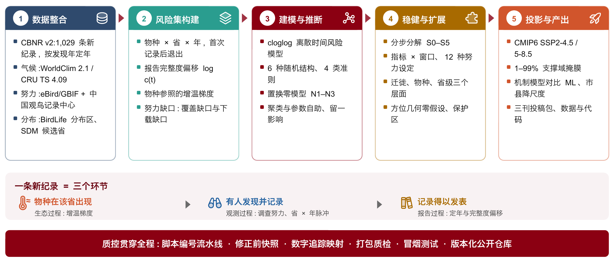
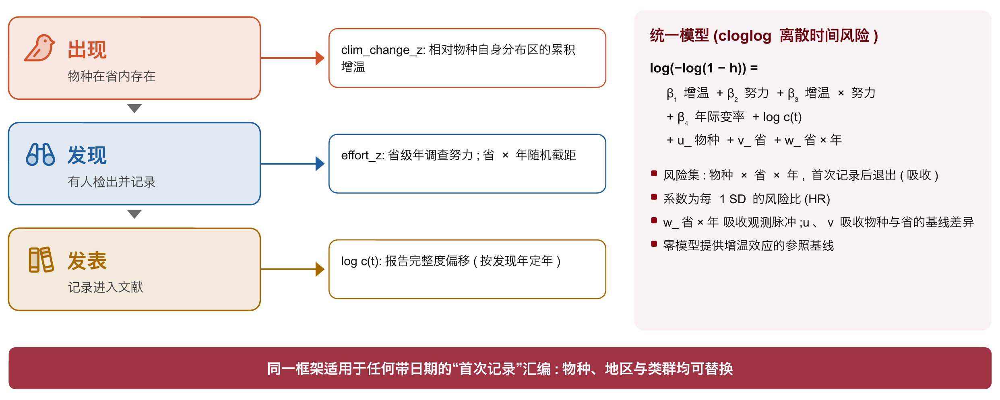

# 研究概述

| 项目 | 内容 |
|---|---|
| 研究题目 | Warming and survey effort contribute comparably to new bird distribution records when dated to discovery |
| 研究对象 | 中国省级鸟类新分布纪录(CBNR v2,1,029 条,2000–2025) |
| 分析单元 | 物种 × 省 × 年风险集(175,640 行、649 个事件、392 种、31 个省级单元,2002–2024) |
| 核心方法 | 互补双对数(cloglog)离散时间风险模型;物种、省、省 × 年三个随机截距;报告完整度偏移 |
| 一句话结论 | 按发现年定年并显式建模观测过程后,累积增温(HR 1.36)与调查努力(HR 1.43)贡献相当且负交互(HR 0.84);记录的日期决定哪一个“看起来”占主导 |
| 目标期刊 | Global Change Biology、Nature Ecology & Evolution、Nature Communications(三个版本) |
| 数据与代码 | CBNR v2:doi:10.5281/zenodo.20809949;代码:github.com/dingchenchen6/bird-newrecord-discovery-dated |

# 研究背景

物种在此前没有记录的地点被发现,常被当作分布区随气候变化移动的证据。许多类群的分布边界随升温向高纬、高海拔移动,这种再分布影响生态系统与人类福祉。在中国,省级鸟类新纪录汇编也被解读为向北、向高纬扩张的信号。

然而,一条新纪录并不是对“移动”的直接观测。它是三个事件链条的最后一环:物种在某地出现、有人在那里发现它、发现被发表。只有第一个环节是生态过程。不完全探测与不均匀采样本身就能在没有真实变化的地方制造“分布区变化”。

问题在于,观测的增长与气候变化同样迅速。已记录的分布既反映物种在哪里,也反映人们在哪里观察;许多被报告为“新”的纪录只是填补了知识空白(华莱士短缺),并不对应分布区变化。中国大陆 eBird 与中国观鸟记录中心记录的年观鸟访问量,从 2002–2004 年均 493 次增至 2022–2024 年均 99,156 次,约 200 倍,恰好覆盖了上述“北移”被报告的时期。任何同期新纪录序列都会与观测增长相关,不论气候贡献多大。机会性记录只有在记录过程被建模时才能给出无偏趋势,但首次记录汇编此前从未以这种方式分析。

| 关键事实 | 数值 | 含义 |
|---|---|---|
| 观鸟访问量增幅 | 约 200 倍(2002–04 → 2022–24) | 观测与增温同步增长,信号纠缠 |
| 省级新纪录 | 1,029 条(CBNR v2) | 有发现日期与发表年两个时间 |
| 平均发表滞后 | 2.09 年(中位 1 年;81.7% 滞后 ≥ 1 年) | 按发表年定年会错配协变量年份 |

# 研究空缺与不足

三个环节各自在数据中留下特征,但已有分析没有把它们分开。我们归纳为四个空缺:

| 空缺 | 现状与后果 | 本研究对策 |
|---|---|---|
| 1. 时间:按发表年定年 | 汇编按发表年定年,而发表滞后于发现。观测逐年增长,记录被计入观测者更多的年份;近年发现尚未发表,末端年份不完整。偏差的大小与方向从未被测量 | 按发现年定年;用发表滞后的经验分布构造报告完整度偏移 log c(t) |
| 2. 尺度:观测的省 × 年脉冲 | 调查活动、观鸟节、新保护区或新平台会使某省某年的记录骤增。只含物种与地区随机效应的模型无法表示这种脉冲,其大小以及是否扭曲驱动因子估计未知 | 加入省 × 年随机截距,并比较六种随机结构 |
| 3. 基准:气候效应与谁比较 | 以物种自身分布区为参照的增温效应,应与“物种身份不含信息时共享区域气候会产生的效应”比较,而这一基准不一定等于 1 | 三个保持数据结构的置换零模型(N1–N3) |
| 4. 外推:投影的支撑域 | 气候情景下的新纪录投影很少检查是否超出拟合范围 | 以拟合样本 1–99% 分位定义支撑域并掩膜;机制模型与机器学习模型对比 |

此外,数据层面还存在两类常被忽视的不足:一是努力数据中的“零”并不都是真零(24 个大陆省-年恰为零,而相邻年份有 1–27 次访问),二是数据源可能存在下载缺口(本研究在复核中发现 eBird/GBIF 源文件止于 2023 年,见第 8.3 节)。两者都会直接影响努力系数。

# 科学问题与研究假设

**核心问题**:在显式建模发表与观测过程之后,增温能否可测地提高中国省级鸟类新纪录的产生速率?其贡献与调查努力相比如何?

我们在开展稳健性分析之前写定了四个预测:

| 假设 | 预测 | 机制 | 检验方式 |
|---|---|---|---|
| H1 定年偏差 | 按发表年定年会抬高努力系数、制造年际气候变率的伪效应,而累积增温几乎不变 | 1–2 年的滞后把记录移入观测更多、天气不同的年份,却几乎不改变 15 年均值 | 分步分解 S0 → S1 |
| H2 观测脉冲 | 省 × 年脉冲是风险中最大的未解释变异,但吸收它不改变固定效应的判别力 | 脉冲短暂,与长期趋势无关 | 随机结构阶梯 R0–R5;边际与条件 AUC |
| H3 负交互 | 增温与努力负交互 | 每对物种 × 省只能“首次”记录一次;努力长期高的省,增温有利的物种多已被记录 | 交互项 HR < 1 |
| H4 回报递减 | 努力的回报随时间下降,增温的回报不降 | 可检出但未记录的存量被逐步耗尽;增温则持续增加候选 | 时变系数与比例风险检验 |

# 研究框架与技术路线

研究把一条新纪录拆成三个环节,并为每个环节指定一个模型分量:

- **出现(生态过程)**:物种参照的累积增温 clim_change,即目标省比该物种历史分布区多增温多少;
- **发现(观测过程)**:省级年调查努力 effort,以及吸收观测脉冲的省 × 年随机截距;
- **发表(报告过程)**:按发现年定年,并以报告完整度偏移 log c(t) 校正末端年份的不完整。

技术路线分五个阶段:数据整合 → 风险集构建 → 建模与推断 → 稳健性与扩展分析 → 投影与产出。质控措施(脚本编号流水线、修正前快照、数字追踪映射、打包质检、冒烟测试、公开仓库)贯穿全程。这一框架不依赖鸟类或中国,适用于任何带日期的首次记录汇编。

# 数据与来源

| 数据类型 | 来源 | 内容与规模 | 用途 |
|---|---|---|---|
| 新纪录 | CBNR v2(Ding et al., 2026) | 1,029 条省级新纪录,2000–2025;发现日期与发表年;大语言模型辅助抽取 + 逐条人工核验 | 事件与定年 |
| 气候 | WorldClim 2.1 降尺度 CRU TS 4.09 | 10′ 月均温,1980–2024;年均温、冬季均温、最热月最高温、最冷月最低温 | 增温梯度、年际变率 |
| 调查努力 | eBird/GBIF + 中国观鸟记录中心 | 省 × 年访问、观测者、观鸟日、记录数;2024 年 eBird 由 GBIF 另行补入(doi:10.15468/dl.vfeeak) | 努力协变量 |
| 物种分布 | BirdLife 分布区 + 物种分布模型 | 2.5′ 适宜栅格;50/100/200 个栅格阈值确定候选省 | 风险集、物种参照 |
| 性状与系统树 | 中国鸟类生态性状库、BIRDBASE、AVONET、Clements 定年树 | 1,445 种;1,312 种可匹配系统树 | 物种层面分析 |
| 情景与保护地 | CMIP6 四模式集合;全国自然保护区边界 | SSP2-4.5 / SSP5-8.5,2030/2050/2080;1,028 处已制图保护区 | 投影、保护地模块 |

物种名依次按中国生物物种名录 2026、BirdLife v10、Clements v2025 统一;西藏统一为 Tibet。港澳台因努力数据覆盖不全不入模型。

# 方法与分析

## 事件定年与报告完整度

1. 从发现日期中解析四位年份:1,029 条中 1,028 条可解析;另有 9 条发现年晚于发表年(内部矛盾)。这 10 条以“发表年 − 中位滞后 1 年”替代并在数据中标记。
2. 每个物种 × 省只保留最早的事件年,之后的报告视为再记录;最早记录早于 2002 年的组合视为分析期开始时已存在,移出风险集。
3. 令 F 为非负发表滞后的经验累积分布,P~max~ = 2025 为汇编中最晚的发表年。在第 t 年发现的记录,只有滞后不超过 P~max~ − t 才可能已发表,因此完整度 c(t) = F(P~max~ − t)。c(2002) = 0.997,c(2024) = 0.567。
4. 在不完全报告下观测风险约为 c(t)·h(t);在 cloglog 链接下这恰好是偏移项 log c(t),所有模型都包含它。滞后平稳性用 Spearman 相关、Wilcoxon 检验与累积分布比较核查。
5. 按发现年定年改变了 83.1% 的事件年份。

## 风险集构建

每个物种的候选省 = 其物种分布模型标出至少阈值数量适宜栅格的省 + 实际有记录的省。栅格中位面积 18.3 km²,50/100/200 个栅格分别约相当于省内 0.9、1.8、3.7 千 km² 的适宜生境。每个物种 × 省组合从 2002 年起每年贡献一行,直到首次记录后退出(吸收退出)。50 栅格阈值下得到 8,319 对、185,478 行、657 个事件;去除协变量缺失后建模样本为 175,640 行、649 个事件。

## 气候变量

物种参照的增温梯度为

x(s, p, t) = [T(p, t) − T~base~(p)] − [N(s, t) − N~base~(s)]

即目标省 p 比物种 s 的历史中国分布区多增温多少。T 为省级面积加权均值,N 为物种分布区多边形均值,基线均为 1980–2000 年。x 严格向后分解为累积分量与残差:

- clim_change(s, p, t):x 在 [t − W + 1, t] 内的均值(主分析 W = 15 年,年均温);
- clim_var(s, p, t) = x − clim_change(年际变率)。

气候面板回溯至 1980 年,因此任何窗口下都不丢失分析期行。敏感性分析使用 4 个指标 × 4 个窗口(5/10/15/20 年)、3–23 年细网格与 3 个基线。

## 调查努力

1. 四个代理:访问次数、不同观测者数、观鸟日数、记录数;由去重后的 eBird/GBIF 记录与中国观鸟记录中心清单汇总到省 × 年。
2. 2024 年 eBird 清单从 GBIF 另行下载补入,沿用同一访问定义(对 2023 年逐值复现);广东 2024 年中国观鸟记录中心只有 14 天数据,作为下载缺口按缺失处理;投影时广东 2024 年努力沿用 2023 年值。
3. 24 个大陆省-年恰为零,视为覆盖缺口(其中 22 个相邻年份有 1–27 次访问),主分析中为缺失;敏感性分析采用补零(旧做法)与对数尺度线性插补两种规则。港澳台 39 个省-年无覆盖。
4. 各代理 log1p 变换后在分析范围内标准化。1 SD 努力约相当于年访问量 7.89 倍(中位 60.5 → 约 478 次)。

## 主模型与随机结构选择

$$\log[-\log(1-h_{spt})] = \beta_0 + \beta_1 C + \beta_2 E + \beta_3 (C \times E) + \beta_4 V + \log c(t) + u_s + v_p + w_{pt}$$

式中 C、E、V 分别为标准化的累积增温(clim_change)、调查努力(effort)与年际变率(clim_var)。

u~s~、v~p~、w~pt~ 分别为物种、省、省 × 年随机截距。所有预测变量在分析样本上标准化,系数解释为每 1 SD 的风险比(HR)。模型用 glmmTMB 拟合。

六种随机结构按四类准则比较:AIC/BIC;解释率(McFadden 伪 R²、Nakagawa 边际与条件 R²、边际与条件 AUC);方差分量可识别性;各随机项的生态学含义。结构在稳健性分析之前冻结。

| 结构 | ΔAIC | McFadden R² | 边际 R² | 条件 R² | 条件 AUC |
|---|---|---|---|---|---|
| R0 物种 | 160.6 | 0.015 | 0.113 | 0.187 | 0.688 |
| R1 + 省 | 95.5 | 0.023 | 0.129 | 0.279 | 0.722 |
| R2 + 年 | 73.1 | 0.025 | 0.085 | 0.282 | 0.737 |
| **R3 + 省 × 年(主模型)** | **3.3** | **0.033** | **0.088** | **0.413** | **0.853** |
| R4 + 物种增温斜率 | 2.6 | 0.034 | 0.085 | 0.405 | 0.864 |
| R5 + 省努力斜率 | 0.0 | 0.034 | 0.088 | 0.400 | 0.851 |

R4、R5 的 AIC 略低,但条件 R² 更低,固定效应几乎相同(努力 1.422、1.404;增温 1.351、1.368),因此冻结最简约、条件 R² 最高的 R3。

## 分步分解与稳健性

- **分步分解 S0–S5**:从“按发表年定年、零值照用、非面积加权气候、无偏移、无省 × 年”的旧设定出发,每次只改一个选择(发现年定年 → 覆盖缺口 → 面积加权气候 → 完整度偏移 → 省 × 年截距),量化每一步对系数的影响。
- **敏感性网格**:4 个气候指标 × 4 个窗口(同一样本、AIC 可比);3–23 年细网格(最优位于 18–20 年内部);3 个气候基线(含 CRU 1970–2000);12 种努力设定(4 个代理 × 3 种缺失规则);3 个 SDM 阈值;剔除偏移、截断至 2021 年。
- **扩展分析**:迁徙策略分层与调节作用似然比阶梯;物种层面系统发育逻辑回归(另以分类嵌套与系统发育特征向量作替代处理);省级新纪录计数的负二项模型与层次分割;新纪录相对分布区质心的方位(几何与努力加权蒙特卡洛零假设);保护区内纪录与观测过程的关系。

## 零模型、重抽样与诊断

| 类别 | 设计 | 用途 |
|---|---|---|
| 置换零模型 | N1:省-年内打乱物种的增温;N2:省内打乱努力的年份;N3:省-年内打乱事件落在哪个物种;各 199 次 | 为增温与努力效应提供保持数据结构的参照基线 |
| 聚类自助 | 物种(392 簇)与省(31 簇)各 300 次,只重命名被抽样的分组变量 | 评估聚类导致的标准误放大 |
| 参数自助 | 由拟合模型模拟 150 个响应向量(含随机效应重抽)并重拟合 | 偏倚与区间覆盖率 |
| 影响分析 | 逐省及物种十等分留一,共 41 次重拟合 | 单个省或物种组的影响 |
| 残差诊断 | DHARMa 模拟残差(500 次):均匀性、离散、离群、零膨胀、按年与按省分组;省均残差 Moran's I(999 次置换);各焦点项 × 年份的比例风险检验 | 模型假设核查 |

少数重抽样收敛到退化最优解,会影响基于均值或标准差的统计量;|log HR| > 2 的抽样被剔除并报告数量(N3 3/199,物种自助 3/300,其余为 0)。推断一律基于百分位量。

## 投影与外推边界

1. CMIP6 四模式集合中位增温差(SSP2-4.5、SSP5-8.5;2030、2050、2080 年)分别加到省与物种分布区两端;努力按每十年 0.30(SSP2-4.5)与 0.60(SSP5-8.5)SD 增长。
2. 预测时省 × 年效应取期望、偏移取 log 1,因此投影的是潜在生成风险。
3. 支撑域定义为拟合样本累积增温与努力的 1–99% 分位;主图只汇总支撑域内单元,并在每个面板标注合格比例。
4. 另设 2 × 2 × 2 情景网格(SSP × 努力冻结或增长 × 2030/2050),分离气候轴与观测轴。
5. 用梯度提升模型(XGBoost,TreeSHAP 解释)作对比;并在省级风险集与市、县级分配集上比较随机森林、XGBoost 与机制模型的交叉验证技能。

# 质控、可复现与数据审计

## 脚本流水线

| 编号 | 阶段 | 主要内容 |
|---|---|---|
| 130–132 | 数据层 | 发现年定年与完整度;努力面板(三种缺失规则);建模矩阵(三个阈值) |
| 133–147 | 模型层 | 随机结构阶梯、指标 × 窗口、分解、全比较矩阵、诊断、投影、敏感性、迁徙策略 |
| 148–192 | 扩展与推断 | 物种与省级层面、方位、保护地(160–166)、降尺度(170–173)、模型族对比(180–188)、零模型与重抽样(190–192) |
| 200–221 | 投稿与图件 | 三刊投稿包、参考文献裁剪、三线表、可编辑图件、顶刊版图、数据与代码快照、时空动图 |
| 222–231 | 数据审计 | 2024 年努力修正、新旧对照、数字追踪映射与应用、主稿表格渲染、讲稿数字、文档重渲染 |

脚本按编号顺序运行,每一步只读上一步落盘的结果。R 脚本统一用 `Rscript --no-init-file` 从任务根目录运行。

## 质控措施

- **修正前快照**:任何全流程重跑之前,对数据、结果表与文稿做整体快照,任何数字都可回溯旧值。
- **数字追踪映射**:每个数字写成可跨版本共享的短片段模板,分别用旧数据与新结果填充;旧片段必须在原文逐字命中才证明口径一致(本轮 171 个片段,156 个数值改变)。主稿表格先用旧数据渲染、与原表逐字一致后才写入新值。
- **打包质检**:关键数字三版一致、作者-年份与数字引文完整、撤回结论不再出现、占位符清单、上传件齐全;0 失败才放行。
- **冒烟测试**:由仓库分发的数据重拟合主模型,须复现样本量、四个 HR 与 AIC(约两分钟)。
- **独立复核**:只读核查代理按结果表逐段回溯约 350 个数字。
- **公开与归档**:GitHub 仓库、data_and_code 快照;CBNR v2 已在 Zenodo 发布,代码将在论文接收后归档 Zenodo。

## 数据审计实例:2024 年调查努力

| 步骤 | 内容 |
|---|---|
| 发现 | 努力面板中云南 2024 年访问 5 次(2023 年 1,802 次),广东骤降,而记录数口径平稳 |
| 根因 | eBird/GBIF 事件文件止于 2023 年;广东 2024 年中国观鸟记录中心只有 14 天 |
| 修正 | 从 GBIF 补入 eBird 2024 年中国数据,沿用同一访问定义(对 2023 年逐值复现);广东 2024 年按下载缺口处理 |
| 重跑 | 数据层、模型层、零模型与重抽样、投影、县级与机器学习、全部图件与动图;三刊正文、SI、表格、图注、投稿信同步更新 |
| 影响 | 建模行 175,901 → 175,640;努力 HR 1.404 → 1.429;增温 1.362 → 1.365;交互 0.849 → 0.839;结论不变 |

这一实例说明:单个数据源的下载缺口会在不引人注意的情况下系统性低估末端年份的努力,因此努力面板的逐年合计与跨口径一致性应作为常规检查。

# 主要结果与假设检验

| 结果 | 估计值(95% CI) |
|---|---|
| 累积增温 HR(每 1 SD) | 1.365(1.219–1.528);省级聚类自助 1.20–1.72 |
| 调查努力 HR(每 1 SD) | 1.429(1.268–1.611);省级聚类自助 1.24–1.78 |
| 增温 × 努力 HR | 0.839(0.752–0.936);省级聚类自助 0.73–0.99 |
| 年际气候变率 HR | 0.995(0.908–1.089) |
| 省 × 年随机截距 | σ = 0.798(风险 × 2.22),最大方差分量 |
| 增温零分布中位(N3) | 1.161;物种特异增量约 1.18 |
| 打乱努力时间后的努力 HR(N2) | 0.979 |

| 假设 | 结论 | 证据 |
|---|---|---|
| H1 | 支持 | 发表年定年使努力 HR 虚高 37%(1.79 对 1.31),并制造年际变率伪效应(0.85);累积增温几乎不变(1.39 → 1.44) |
| H2 | 支持 | 省 × 年为最大方差分量;条件 AUC 由 0.72 升至 0.85,边际判别力不变 |
| H3 | 支持 | 交互 HR 0.84(0.75–0.94) |
| H4 | 支持 | 努力回报由 2002 年 2.14(1.61–2.85)降至 2024 年 1.13(0.93–1.37),2023 年起不显著(P = 2.1 × 10⁻³);增温回报无可检出变化 |

其他结果:

- **稳健性**:12 种努力设定下增温 HR 1.33–1.39;残差校准良好(KS P = 0.86,离散 P = 0.51,零膨胀 P = 0.52),无空间自相关(Moran's I = −0.042,P = 0.76);参数自助偏倚 ≤ 0.008,覆盖率 92.0–93.3%;留一最大偏移 3.9%。
- **迁徙策略**:改变基线风险,但不调节任一驱动因子(增温 × 策略 LR P = 0.692;努力 × 策略 P = 0.638;三阶交互 P = 0.260)。
- **物种层面**:三种系统发育处理下部分迁徙鸟产生新纪录的几率约为留鸟两倍(OR 1.89–2.50),分布区面积每 1 SD 提高几率 1.23–1.46 倍。
- **方位**:相对分布区质心的“偏东”可由地理几何完全复现;扣除几何与努力后略偏北(40.2% 对期望 32.8%)。
- **投影**:支撑域内单元比例 SSP2-4.5 为 45.7%、6.3%、0%,SSP5-8.5 为 30.3%、0%、0%(2030/2050/2080);努力比增温更早出界;机制模型与 XGBoost 在支撑域外的方向一致率仅 8.6%。

# 产出清单

| 类别 | 产出 | 位置 |
|---|---|---|
| 投稿稿 | GCB、NEE、NC 三个版本(正文、SI、投稿信、Reporting Summary、中文摘要) | analysis_v2/submission/{GCB,NEE,NC}/ |
| 图件 | 102 个可编辑 PPTX 图件、顶刊版主图、源数据 | analysis_v2/figures_topjournal/;各刊 figures/ |
| 数据与代码 | 100 个脚本、101 张结果表、data_and_code 快照(含冒烟测试) | analysis_v2/submission/data_and_code/;GitHub |
| 数据集 | CBNR v2(CC BY 4.0) | Zenodo doi:10.5281/zenodo.20809949 |
| 报告 | AOC 2026 新加坡报告(v3 四个版本、v4 北大红版)、2002–2024 时空动图 | analysis_v2/submission/presentation/ |
| 审计 | 数字追踪映射、新旧对照、审计报告 | analysis_v2/effort2024_audit/ |
| 工作流 | 本文档、工作流 PPT 与网页 | analysis_v2/workflow/ |

# 局限与下一步

**局限**

1. 新纪录汇编依赖文献发表,未发表的发现与灰色文献未纳入;按发现年定年依赖发现日期字段的质量(10 条为替代值)。
2. 调查努力来自 eBird 与中国观鸟记录中心,未覆盖专业调查;努力的标准化范围包含香港(大陆以外),以大陆为范围时 1 SD 对应 7.80 倍。
3. 物种参照的增温梯度依赖 BirdLife 分布区的精度;候选省依赖物种分布模型阈值(三个阈值结果一致)。
4. 投影只在支撑域内可解读;2050 年后多数单元超出拟合范围,只作情景演示。
5. 网格尺度分析受限于努力数据的空间覆盖与事件数(网格风险集仅 48 个事件)。

**下一步**

1. 投稿前:作者确认审计报告中的措辞建议、资助与 CRediT 信息,补充 2002–2023 年 eBird/GBIF 下载 DOI。
2. 投稿:按目标期刊上传对应投稿包;接收后将代码与结果表归档 Zenodo。
3. 扩展:把同一框架用于两栖爬行类与哺乳类新纪录;积累更长的网格尺度努力序列。
4. 应用:生成县级优先调查清单,并与保护区监测嫁接。

# 附录:关键参数

| 参数 | 取值 |
|---|---|
| 分析期 | 2002–2024(气候面板 1980–2024) |
| 主气候指标与窗口 | 年均温;W = 15 年;基线 1980–2000 |
| 主 SDM 阈值 | 50 个适宜栅格 |
| 主努力代理与缺失规则 | 访问次数;覆盖缺口视为缺失 |
| 置换次数 / 自助次数 | 199 / 300(聚类)/ 150(参数) |
| 支撑域 | 拟合样本 1–99% 分位 |
| 努力增长情景 | 每十年 0.30 / 0.60 SD |
| 软件 | R 4.5.1、glmmTMB 1.1、DHARMa、ranger、xgboost;Python 3.11(打包与质检) |
